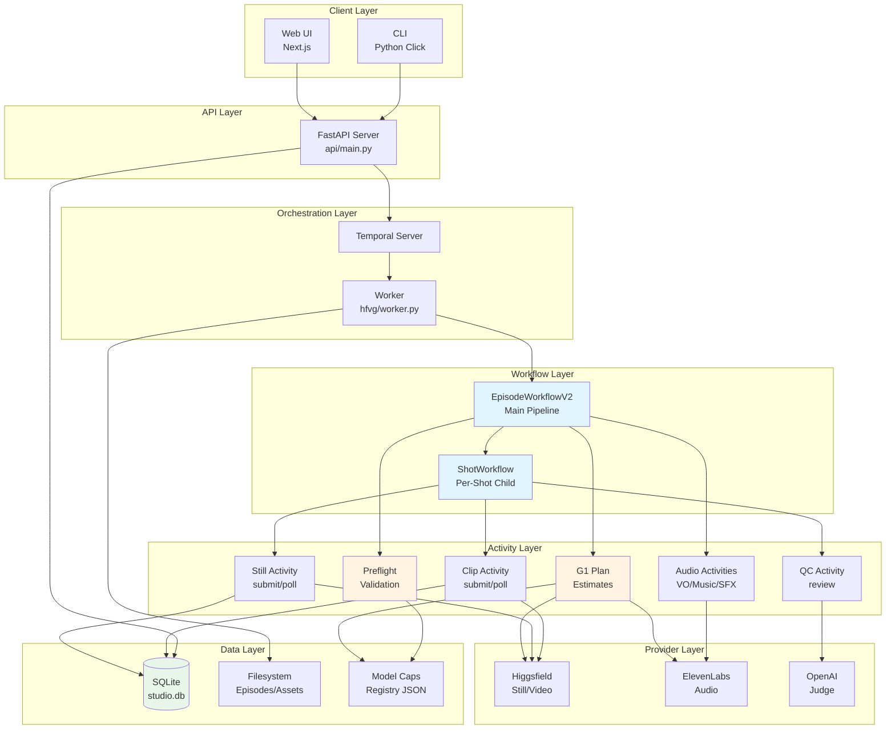
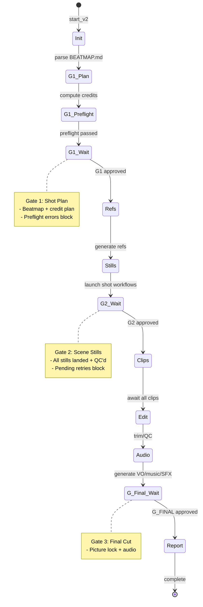
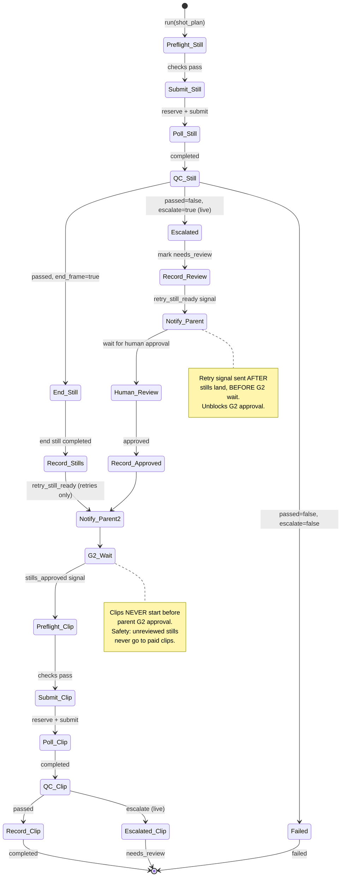
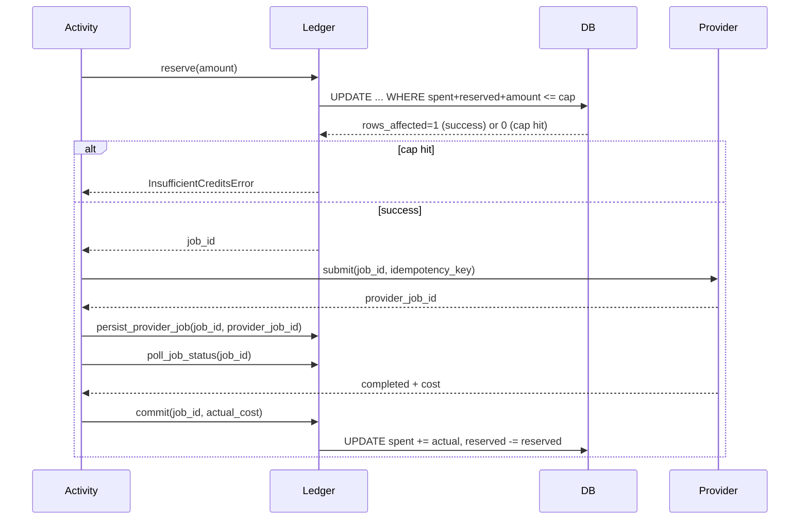

# Architecture

## System Overview

The Hands-Free Video Generator is a **workflow orchestration harness** built on Temporal that coordinates multiple AI providers to transform story ideas into finished videos.



## EpisodeWorkflowV2 Pipeline



### G1: Shot Plan Gate

**Inputs:**
- Parsed beatmap (shot list)
- Credit plan (per-shot + total estimates)
- Preflight validation results

**Validation:**
1. **Preflight errors refuse** (no override) - shots must pass model limits
2. **Live mode + estimates unavailable** refuses (unless `override_unavailable_estimates=true`)

**On approval:**
- Marks G1.08 credit plan approved (DB flag)
- Proceeds to reference generation

**Implementation:** `EpisodeWorkflowV2.approve_g1_shot_plan()` with validator

### G2: Scene Stills Gate

**Inputs:**
- All shot start stills (QC passed or escalated+approved)
- All shot end stills (for end-frame shots)
- Shot completion status

**Validation:**
1. **Pending retries refuse** - unreviewed retry stills must land first
2. All stills must be recorded (needs_review or still_complete)

**On approval:**
- Signals all shot workflows to proceed to clips
- Marks shots as approved in DB

**Implementation:** `EpisodeWorkflowV2.approve_g2_scene_stills()` with validator

**Safety design:**
- Retry children send `retry_still_ready` signal after stills land
- Validator refuses while `pending_retries` non-empty
- Prevents unreviewed retry stills from going to paid clips

### G_FINAL: Final Cut Gate

**Inputs:**
- Picture lock (all clips QC'd)
- Audio mix complete

**On approval:**
- Generates run report
- Marks episode complete

**Implementation:** `EpisodeWorkflowV2.approve_g_final_cut()` (signal, no validator)

## ShotWorkflow

Per-shot child workflow that handles:
1. **Start still**: submit → poll → QC → record
2. **End still** (if `end_frame: true`): submit → poll → record
3. **G2 wait**: parent approval before clips
4. **Clip**: submit → poll → QC → record



## Budget Ledger

**Design:** Atomic SQL reserves prevent overspend



**Atomic reserve SQL:**
```sql
UPDATE episode_budget_lines
SET reserved_usd_micros = reserved_usd_micros + ?
WHERE episode_id = ? AND line_name = ?
  AND (spent_usd_micros + reserved_usd_micros + ?) <= stop_usd_micros
```

**Key properties:**
- **Hard cap**: Reserve only succeeds if `spent + reserved + amount <= stop` (80% of cap)
- **Idempotent**: Same `job_id` (shot_id + version + suffix) → same provider idempotency key
- **Reconciliation**: Poll exhaustion keeps reservation, marks `pending_reconcile` (never releases)
- **Release on failure**: Confirmed provider failure (failed/blocked/canceled) releases reservation

## Model Capabilities Registry

**File:** `hfvg/data/model_caps.json`

**Schema:**
```json
{
  "schema_version": 2,
  "checked": "2026-10-19",
  "recheck_interval_days": 7,
  "models": {
    "xai/grok-imagine-image-2.0": {
      "kind": "still",
      "provider": "higgsfield",
      "status": "active",
      "limits": {
        "max_refs": {"value": 5, "basis": "documented", "sources": ["hf_grok_img"]},
        "prompt_max_chars": {"value": 1000, "basis": "documented", "sources": ["hf_grok_img"]},
        "aspect_ratios": {"value": ["1:1", "16:9", "9:16"], "basis": "documented", "sources": ["hf_grok_img"]}
      }
    }
  },
  "sources": {
    "hf_grok_img": {
      "url": "https://higgsfield.ai/docs/models/grok-imagine-image-2",
      "publisher": "Higgsfield",
      "checked": "2026-10-19"
    }
  }
}
```

**Preflight checks:**
1. **G1 plan** - all shots, all phases (start/end/clip)
2. **Submit activities** - defense-in-depth before reserve/submit

**Enforcement:**
- **Errors refuse** (no retries) - PreflightError is non-retryable
- **Warnings log** (e.g. deprecated models, quality tier mappings)
- **G1 approval validator refuses** while preflight errors exist

## Worker Registration

**File:** `hfvg/worker.py`

Activities registered:
- Budget: `init_episode_budget_lines_activity`, `reserve_budget_activity`, `commit_budget_activity`, `release_budget_activity`
- Credit: `init_episode_credit_line_activity`, `reserve_credits_activity`, `commit_credits_activity`, `release_credits_activity`
- Generation: `submit_still_job_enforced`, `submit_clip_job_enforced`, `poll_job_status`
- QC: `precheck_still_qc`, `precheck_clip_qc`, `review_still`, `review_clip`
- G1: `compute_g1_plan_activity`, `approve_g108_activity`
- Preflight: `preflight_validate_episode_activity`
- Refs: `load_refs_to_generate_activity`, `generate_ref_activity`, `recheck_refs_activity`
- Assets: `save_asset_locally`, `record_shot_result`
- Audio: `generate_voiceover`, `generate_music`, `generate_sfx`, `mix_audio` (PR #8)
- Workflow support: `parse_beatmap_activity`, `load_gate_policy_activity`, `verify_episode_files_activity`
- Retries: `resolve_landed_start_still` (end-frame backfill)

Workflows registered:
- `EpisodeWorkflowV2`
- `ShotWorkflow`
- `PostingWorkflow` (stub)

## Data Model

### Database Schema (SQLite)

**episodes**
```sql
CREATE TABLE episodes (
    episode_id TEXT PRIMARY KEY,
    beatmap_path TEXT,
    created_at TEXT,
    live_mode INTEGER DEFAULT 0,  -- 0=dry, 1=live
    g108_approved INTEGER DEFAULT 0
)
```

**episode_budget_lines**
```sql
CREATE TABLE episode_budget_lines (
    id INTEGER PRIMARY KEY,
    episode_id TEXT,
    line_name TEXT,
    cap_usd_micros INTEGER,
    stop_usd_micros INTEGER,  -- 80% of cap
    spent_usd_micros INTEGER DEFAULT 0,
    reserved_usd_micros INTEGER DEFAULT 0,
    created_at TEXT,
    UNIQUE(episode_id, line_name)
)
```

**budget_jobs**
```sql
CREATE TABLE budget_jobs (
    job_id TEXT PRIMARY KEY,
    episode_id TEXT,
    shot_id TEXT,
    job_type TEXT,  -- 'still' or 'clip'
    line_name TEXT,
    reserved_usd_micros INTEGER,
    status TEXT,  -- 'reserved', 'committed', 'released', 'pending_reconcile'
    provider_job_id TEXT,
    provider_model_path TEXT,
    actual_cost_usd_micros INTEGER,
    created_at TEXT,
    committed_at TEXT,
    idempotency_key TEXT UNIQUE
)
```

**shots**
```sql
CREATE TABLE shots (
    id INTEGER PRIMARY KEY,
    episode_id TEXT,
    shot_id TEXT,
    status TEXT,  -- 'needs_review', 'still_complete', 'completed'
    still_url TEXT,
    clip_url TEXT,
    metadata TEXT,  -- JSON
    retry_count INTEGER DEFAULT 0,
    prompt TEXT,
    created_at TEXT,
    UNIQUE(episode_id, shot_id)
)
```

**anchor_stills**
```sql
CREATE TABLE anchor_stills (
    id INTEGER PRIMARY KEY,
    episode_id TEXT,
    anchor_shot_id TEXT,
    file_path TEXT,
    approved_by TEXT,
    created_at TEXT,
    UNIQUE(episode_id, anchor_shot_id)
)
```

### Filesystem Layout

```
data/
├── studio.db                      # SQLite database
├── episodes/
│   ├── ep04/
│   │   ├── BEATMAP.md            # Shot list with prompts
│   │   ├── CONTINUITY.md         # Character/location descriptions
│   │   ├── shots.json            # Per-shot params (model, duration, refs)
│   │   ├── refs.json             # Reference image registry
│   │   ├── prompt_kit.json       # Lint rules, character codes, etc.
│   │   ├── stills/
│   │   │   ├── A01_v1.jpeg       # Start stills
│   │   │   ├── A01_end_v1.jpeg   # End stills
│   │   │   └── ...
│   │   ├── clips/
│   │   │   ├── A01_v1.mp4
│   │   │   └── ...
│   │   └── refs/
│   │       ├── duck-profile.jpeg
│   │       └── ...
│   └── ep05/
│       └── ...
├── normalized/                    # Normalized reference cache
│   └── <sha256>_<size>.jpeg
└── upload_cache.db               # Higgsfield upload URL cache
```

## Retry System

### Shot Retry

**Endpoint:** `POST /api/episodes/{id}/retry-shot/{shot_id}`

**Workflow:** `EpisodeWorkflowV2.retry_shot()` update handler

**Flow:**
1. Validator checks:
   - Parked at G1 or G2 (not after G2 approval)
   - Shot in `failed_shots` or previously retried
   - No pending retry for this shot
   - Under `MAX_SHOT_RETRIES` limit (default 3)
2. Increment `shot_attempts[shot_id]`
3. Launch child with new workflow ID: `{episode}-shot-{shot_id}-retry{n}`
4. Add to `pending_retries` (blocks G2 until still lands)
5. Background task tracks completion, clears `pending_retries`

**Idempotency:**
- Each retry has unique workflow ID and version
- Job IDs include attempt: `still-{episode}-{shot}-r{attempt-1}`
- Provider idempotency key includes attempt

### End-Frame Backfill

**Endpoint:** `POST /api/episodes/{id}/retry-end-still/{shot_id}`

**Workflow:** `EpisodeWorkflowV2.retry_end_still()` update handler

**Use case:** Shot's start still landed but _end failed

**Flow:**
1. Resolve landed start still (committed status)
2. Launch child with `reuse_start_still` flag
3. Child skips start still submit (cost=0)
4. Generates _end still with start still as lead ref
5. Uses same attempt/version (deterministic job_id)

## Testing Strategy

### Test Pyramid

```
┌─────────────────────────┐
│   Mutation Tests (218)  │  ← Red-green proofs
├─────────────────────────┤
│  Integration Tests      │  ← Real Temporal workflows
│  (pytest, time-skip)    │
├─────────────────────────┤
│   Unit Tests            │  ← Fast, no external deps
│  (pytest)               │
└─────────────────────────┘
```

**Mutation testing:** `./scripts/redgreen.sh`
- 218 mutations across safety-critical code paths
- Each mutation must cause test failure (red)
- Restoration must pass test (green)
- Classifies failures (AssertionError vs other)

**Integration tests:** `pytest`
- Real Temporal workflows with time-skipping
- SQLite in-memory or temp file
- Mocked provider APIs (respx)

**Smoke tests:** `pytest tests/test_smoke_test.py`
- No Temporal required
- Fast module imports, config validation

## Security & Safety

### Budget Safety

1. **Atomic SQL WHERE clause** - cap checked in UPDATE, not before
2. **Stop threshold** - 80% of cap blocks new reserves
3. **Idempotent keys** - retry never double-charges
4. **Poll exhaustion** - keeps reservation, never releases
5. **GC.01 headroom** - $12.00 balance required after holds

### Auth

- **API:** `Authorization: Bearer {ADMIN_SECRET}` header (min 32 chars)
- **Fail closed:** No default secret, server refuses to start
- **Session:** Stored in DB, 24h expiry

### Content Policy

- **No named IP** - no franchises, brands, real people
- **Prompt lint** - forbids filter evasion, brand mentions
- **Moderation** - provider-level content filters

### Live Mode Gates

1. **DRY_RUN check** - activities refuse live calls in dry mode
2. **G1.08 check** - generation refuses without credit plan approval
3. **Preflight** - refuses before spend if model limits broken
4. **QC escalation** - live mode escalates to human, never auto-passes

## Monitoring & Observability

### Temporal Visibility

- **Workflow ID format:** `{episode_id}-episode`, `{episode_id}-shot-{shot_id}`
- **Search attributes:** episode_id, shot_id, status
- **Queries:** `get_state()` exposes current stage, gates, shot status

### Logging

- **structlog** - structured JSON logs
- **Provider evidence** - raw response bodies + correlation IDs on failures
- **Audit trail** - budget reserves, commits, releases logged

### Metrics (Future)

- Credits spent per episode/shot
- Generation success rate
- Gate approval latency
- Provider failure rates
- QC escalation rates

## Deployment

### Production Checklist

- [ ] Set `ADMIN_SECRET` (min 32 chars, from secrets manager)
- [ ] Set provider API keys (`HIGGSFIELD_API_KEY`, etc.)
- [ ] Configure `DATABASE_PATH` (persistent volume)
- [ ] Set `EPISODES_DIR` (persistent volume)
- [ ] Deploy Temporal server (prod cluster, not dev)
- [ ] Scale workers (multiple replicas)
- [ ] Set `DRY_RUN=false` for live mode
- [ ] Configure budget caps (`DEFAULT_EPISODE_CAP_USD`)
- [ ] Set up monitoring (Temporal Cloud or self-hosted)
- [ ] Configure backup/restore for SQLite
- [ ] Set `G1_ESTIMATE_PLACEHOLDER_IMAGE_URL` for live clip estimates

### Scaling

- **Workers:** Horizontal - launch multiple worker processes
- **Database:** SQLite → PostgreSQL for multi-writer (requires migration)
- **Temporal:** Self-hosted cluster or Temporal Cloud
- **Provider concurrency:** Controlled by worker count + activity timeouts

## Future Architecture

See [ROADMAP.md](ROADMAP.md) for planned features:
- PostgreSQL support (multi-writer)
- OpenTelemetry tracing
- Per-user spend caps
- Webhook integrations
- Audio stage (PR #8)
