# Easy checkout

Paying for and approving things in the studio should feel like checking out in a good online shop: one
clear price for each thing, in plain words, next to one button. This file is the audit of every place a
user meets money or an approval today (with screenshots), and the plan for making each one calm and
simple. It is a web-only change: the server's money rules stay exactly as they are.

Screenshots of today's flow are in `docs/easy-checkout/before/` at 1440 px and 390 px wide. They come
from the end-to-end test backend (a test-run server, so no real generation). A live studio's answers
were simulated by changing only what the API returned to the browser (for example `dry_run: false` on
an estimate), never by changing the server.

## What does not change

These are the money safety rules. The plan only changes how they are shown.

- **Every paid step has an estimate and an approved total.** The price on screen only ever comes from
  the API's estimate. Pressing the button sends that estimate as the approved total. When the server
  prices the job again at make time and the price is higher, it refuses (409) and nothing is paid.
  With no estimate, there is nothing to approve and the button stays off.
- **The balance gate stays** (a fresh balance, the floor, GC.01). So do reserves, the job ledger and the
  owner checks. The web never sends `override_unavailable_estimates`, and the flag's name never shows up
  on a screen. Today it does: see "Shot plan" below.
- **A live run pays for nothing before its shot plan is approved.** That approval (G1) also gives the
  credit plan approval (G1.08). In a live run, G1 is refused when the provider estimates are unavailable.
- **The admin costs page (`/dashboard`) keeps its full detail.**

## Today: every place a user meets money or an approval

| # | Where | What the user sees today | What is wrong with it |
|---|---|---|---|
| 1 | Wizard trail (`app/studio/create/page.tsx`) | A yellow "$" coin on "Review & start", with the note "Price shown first" | A coin badge, before any price exists |
| 2 | Wizard review, overview | "Estimated cost: $7.44" | The first of three prices on one screen |
| 3 | Wizard review, shot list | Every shot says "5s · kling" | Model names |
| 4 | Wizard review, checkout | "Choose how to proceed:", a lime "Make My Video (uses credits) $7.44", a blue "Preview Only (free test run)" and "Live mode uses real credits and charges you. Preview mode is always free." | Two big buttons fighting each other; "credits" and "live mode" jargon |
| 5 | Wizard confirm dialog | "Confirm Live Production", "This will start a live production run that uses real credits and charges you.", a yellow box "Estimated cost: $7.44. This is an estimate. Actual cost may vary based on retries and model usage.", "Confirm & Start" | A second approval in a row, even though starting a live run pays for nothing. The money is approved later, at the shot plan |
| 6 | Episode page, start card (`StartCard`) | A yellow-ringed "Price" block with a "Test run" chip, "Free" in big type, "Pictures and clips: Free stand-ins", "It starts as a free test run: no credits are used.", a checklist ("Free test run"), "Start the video", "Nothing is charged in a test run." | The same fact ("free") four times. In a live run, the price of the video is never shown here |
| 7 | Next step card (`NextStepCard.tsx`) | The "Your OK needed" chip, a table with "This run: Live: paid providers" and "Spent on this episode so far: $0.00", the fine print "Every paid step shows its price first, and the studio checks it and your balance again before it spends." | Ledger words on every screen, with or without a decision to make |
| 8 | Step trail (`Stepper`) | Yellow "$" coins on Cast, Scene pictures and Final cut, with "Free test run" or "Priced first" under each, and each step's cost once it is done | Coin badges and the cost breakdown are on show all the time |
| 9 | Character sheet (`CastPanel.tsx`) | "Check the price", then a yellow box "3 pictures, about $0.12, charged to this video's budget", "The studio checks the price, your balance and this video's budget again before each picture.", "Make the options". The turnaround repeats the same pattern. Approving says "Approve and lock this look" | Budget words up front; yellow warning colour |
| 10 | First frames (`ConceptFrames.tsx`) | A yellow-ringed "Price" block with a "Checked just now" chip, "$0.09" in big type, "3 options: $0.03 each", "Left in the draft pictures budget: $1.60", a lime "Make 3 options for $0.09" and "Not now" | The price three times; "draft pictures budget" is ledger language |
| 11 | First frames, price went up | Red text from the server: "The estimate is now $0.12 (you approved $0.09); review it and approve again". The old price stays on the button | Red, ledger words, and no clear next step |
| 12 | First frames, balance refusal | Red text: "Balance check failed: Higgsfield balance $0.04 is below the $5.00 floor plus this estimate ($0.09)" | A provider name, "floor", and nothing the user can do about it |
| 13 | Story approval | "Approve the story" | Fine already: no money |
| 14 | Shot plan (G1, `EpisodeRunPanel.tsx`) | "Approve the shot plan". In a live run this approval is when the video gets paid for, but no price is shown there. When the provider estimates fail, the refusal says "Pass override_unavailable_estimates=True to proceed anyway." Shot rows say "5 s · kling" | The one approval that pays for the video has no price on it; it shows the override flag; model names |
| 15 | Picture redo (G2) | "Make this picture again", then a yellow box "1 new picture, about $0.04, charged to this video's budget", "Your note goes with it", "The studio checks the price, your balance and this video's budget again before the picture is made.", "Make it again" | Yellow, budget words, three lines of fine print |
| 16 | Scene pictures (G2) and final cut | "Approve all scene pictures", "Approve the final cut" | Fine: no money (already paid for) |
| 17 | What it cost (finished) | "Real cost of this episode: $0.00", "This run: Test run: free" | Ledger table |
| 18 | Mood board (`UniverseCreation.tsx`) | "Check the price", then a yellow-ringed "Price" block with a "Checked just now" chip: "$1.56", "Mood board budget left now", "Left after this board", "4 pictures, about $1.56, charged to this Universe's mood board budget ($3.20 left)", a list ending in the model name ("with xai/grok-imagine-image-2.0") and the budget's stop and cap, five lines of fine print, a lime "Make my mood board · $1.56", "Cancel" and "Nothing is spent until you press this." | The price four times, a model name, budget stops and caps, a wall of words |
| 19 | Mood board approved | A rubber "APPROVED" stamp over the pictures, plus the chip "Board 1 approved" | A stamp |
| 20 | Lock step, character cards, cast | "Seal each look", round seal badges ("not locked", "locked v1") on the lock step, on Universe character cards and on the cast | Seal badges and "sealed" words |
| 21 | Episode waiting for locks | The lock gate: "Lock the look of ... before this video starts", with the start button off | Fine: one clear reason |
| 22 | Production details (episode page, anyone who can open it) | The budget card ("Higgsfield total", "GC.01 headroom", line names such as `L1_refs`, "AT STOP") and the model limits card (model ids) | Ledger detail and model names for everyone |
| 23 | Admin costs page (`/dashboard`) | Spend, actual against estimate, balances, alerts, by provider | Stays as it is: admins need the detail |

### Screenshots

Wizard trail, overview, shot list, checkout and confirm dialog (1 to 5):

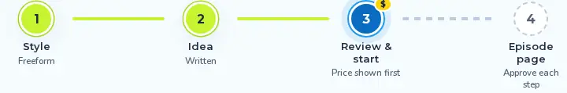
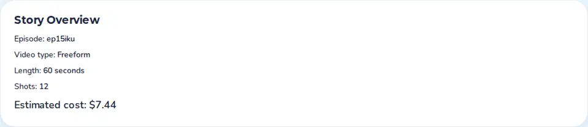
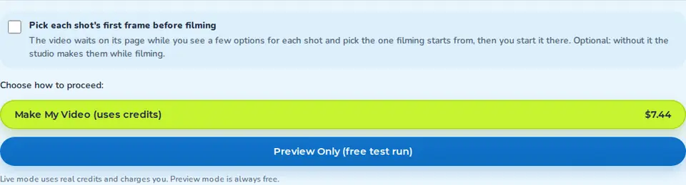
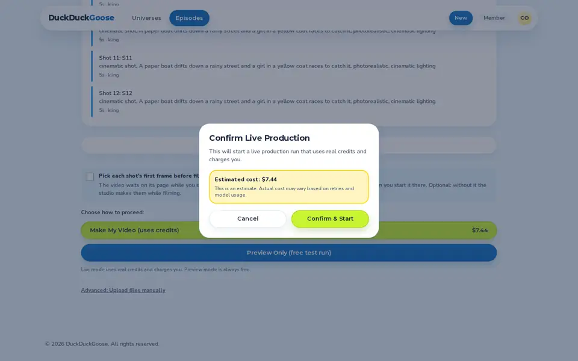
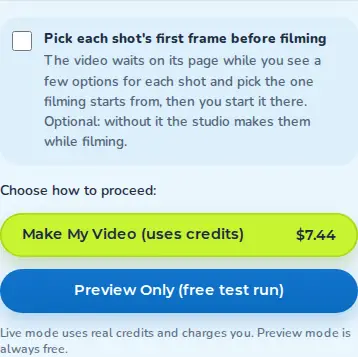
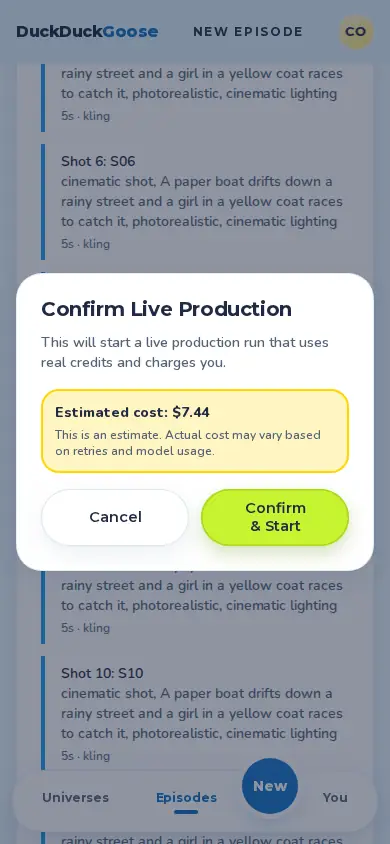

Start card, next step card and step trail (6 to 8):

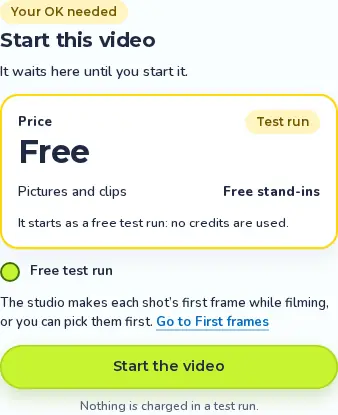
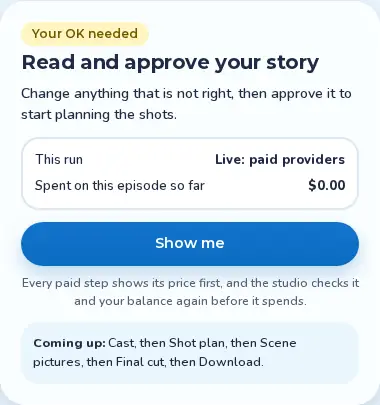

Character sheet (9):

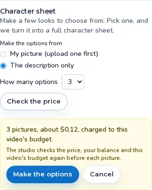
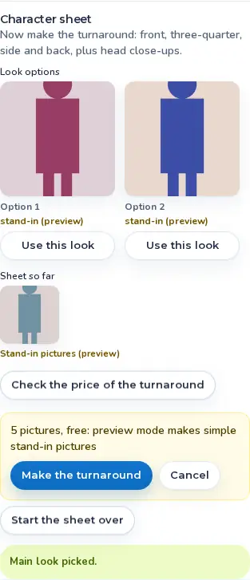
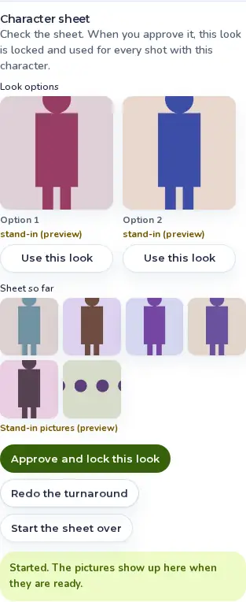

First frames, its price going up and a balance refusal (10 to 12):

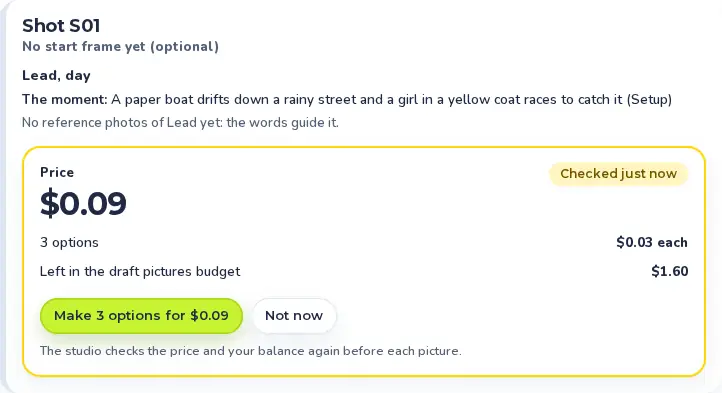
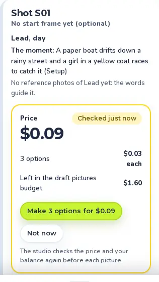
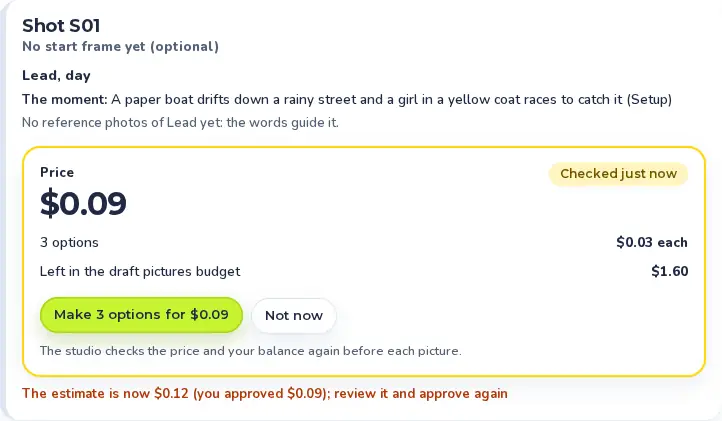
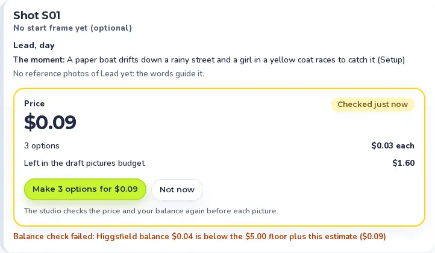

Shot plan (14), picture redo (15) and what it cost (17):

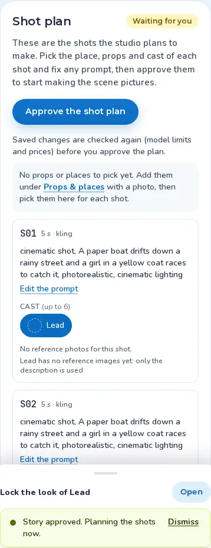
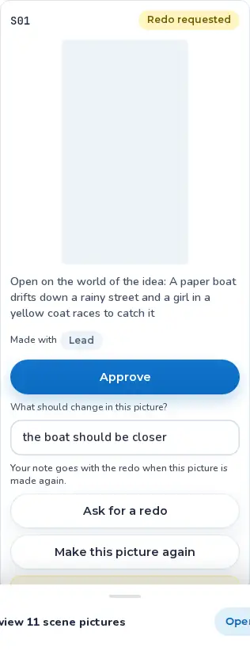
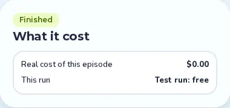

Mood board price, live and test run, and the approved stamp (18, 19):

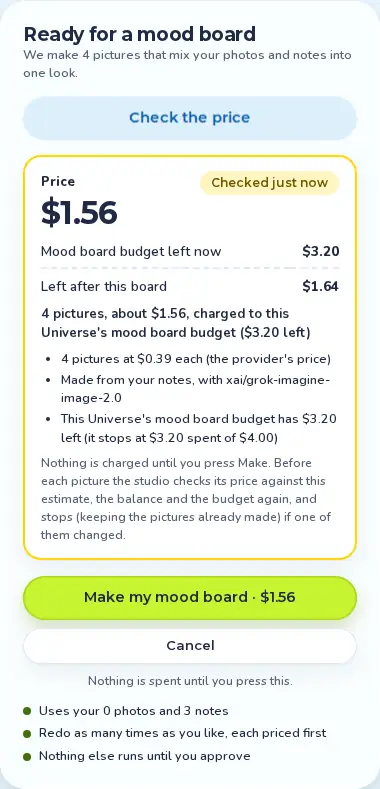
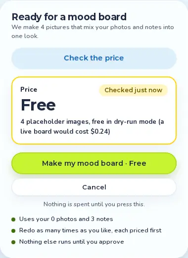
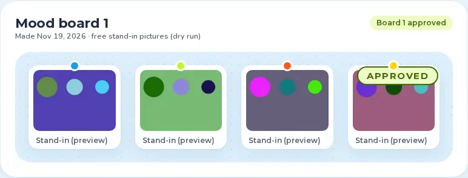

Seal badges (20) and the lock gate (21):

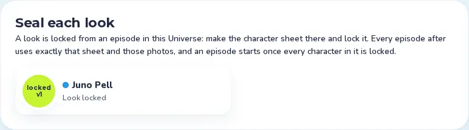
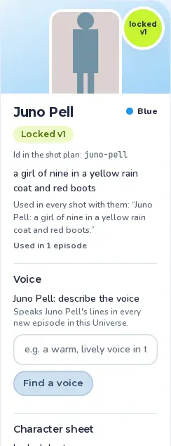
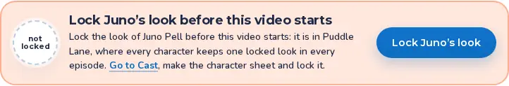

Admin costs page (23, unchanged):

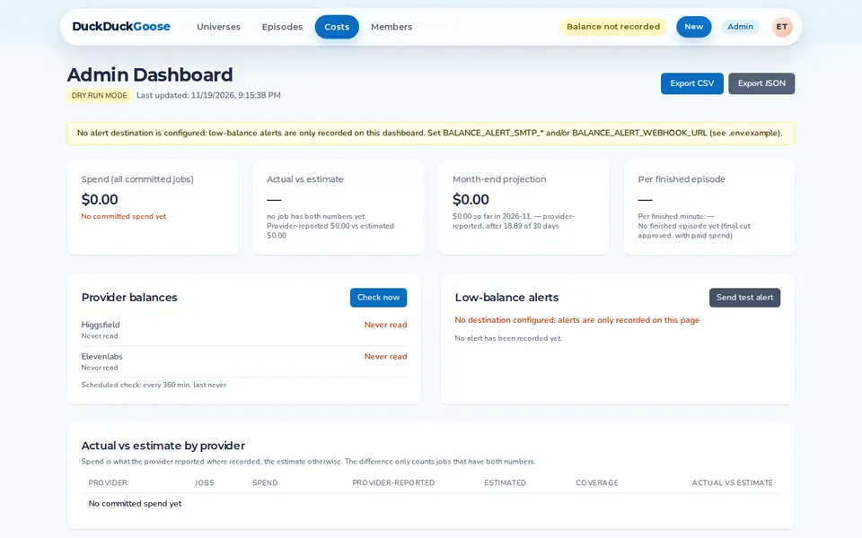

The rest of the set (both widths of every moment) is in `docs/easy-checkout/before/`.

## The plan

### One checkout, everywhere money is spent

A shared `Checkout` (`web/components/Checkout.tsx`), with its words in `web/lib/checkout.mjs` (unit
tested):

- **One headline, in big friendly type:** "3 options: about $0.09", "This video: about $7.44",
  "Mood board: about $1.56". In a test run it says "free" instead of a price. "About" is there because
  the server checks the price again when it makes the thing. The price comes only from the API's
  estimate.
- **One primary button with a plain verb:** "Make 3 options", "Make it", "Make my mood board",
  "Start the video". The price is not repeated on the button.
- **"Not now"** as a quiet text button, where the thing can wait.
- **One calm line under the button.** In a live run: "If the price goes up before we make it, we ask
  you first." In a test run: "A test run, so nothing is charged." The live promise only appears where
  the server keeps it (an approved total that the server re-checks): character sheets, first frames,
  the mood board and a picture redo.
- **"See the breakdown"** is a quiet disclosure, closed by default. It holds what used to be up front:
  the price of each picture, what is left in the budget it is charged to, and what the price is made of.
- **Looks:** a white card with a sky-blue edge. No yellow ring, no status chips, no coin, no lime
  money button. The primary action uses the normal blue primary button.
- **If the price went up** (the server's 409), the card says "The price went up to $0.12 since you
  looked. Nothing was charged." and offers one button, "See the new price". That fetches a fresh
  estimate and shows the checkout again with the new price, and one press makes it. The server stays
  the judge: the new approved total is the new estimate, and nothing is paid until then.

### Money problems in calm words, with one next action

One translator (`moneyProblem` in `web/lib/checkout.mjs`) turns the server's money refusals into plain
words. Each says nothing was charged and offers one next action. Refusals that are not about money keep
the server's own words.

| Server says | The user reads | Next action |
|---|---|---|
| The estimate is now $0.12 (you approved $0.09) | The price went up to $0.12 since you looked. Nothing was charged. | See the new price |
| Balance check failed: ... below the ... floor ... | The studio's balance is too low for this right now. Nothing was charged. An admin can top it up. | Try again |
| No recent balance on record (GC.01) | The studio needs a fresh balance check first. Nothing was charged. An admin can record one on the costs page. | Try again |
| ... has $0.40 left before its stop | This would go past its budget ($0.40 left). Nothing was charged. An admin can raise it. | Try again |
| Estimates unavailable / override_unavailable_estimates | We couldn't get today's prices, so nothing was paid for. Try again in a few minutes. | Try again |

The override flag's name is never shown, and the web still never sends it.

### Each moment, before and after

| # | Moment | After |
|---|---|---|
| 1 | Wizard trail | No coin. The note under "Review & start" says "See the price". |
| 2, 4, 5 | Wizard review, checkout and confirm dialog | One checkout at the bottom: "This video: about $7.44" with "Make it", and a quiet "Make a free preview first". When live is not available: "This video: free preview" with "Make a free preview". The confirm dialog is gone. Starting a live run pays for nothing; the video is paid for when its shot plan is approved, and the price is shown again there. The breakdown lists scene pictures and clips, and says the price is the list price for one try of each (a redo is priced on its own). The overview no longer repeats the price. |
| 3, 14 | Shot lists (wizard and shot plan) | No model names: "5 s" only. |
| 6 | Start card | The checkout: "This video: about $7.44" (live, from the episode's own preflight estimate) or "This video: free test run", then "Start the video". The checklist only lists the looks still to lock, when there are any. |
| 7 | Next step card | No table and no fine print. One quiet line: "Test run: nothing is charged." or "Live: each paid step shows its price first.", plus "Spent so far: $3.20" once a live run has spent something. The chip says "Your turn". |
| 8 | Step trail | No coins. Each step says only "Done", "Now", "Skipped" or "Stopped here". The cost of each step moves into "What it cost", behind "See the breakdown", with the same honesty rules: a paid step says "Free" only for a recorded $0 in a test run, and "Not recorded" when nothing is on record. |
| 9 | Character sheet | The checkout: "3 options: about $0.12" with "Make 3 options", and the same for the turnaround. Approving says "Approve and lock this look" (no change). |
| 10 to 12 | First frames | The checkout: "3 options: about $0.09" with "Make 3 options" and "Not now". The price going up gets the re-ask above, and other money refusals get calm words. |
| 14 | Shot plan (G1) | In a live run, the decision card shows the video's price once ("This video: about $7.44") next to "Approve the shot plan", with the line "This is when the video is paid for. Each picture and clip is checked against its price before it is made." When the run has no prices (`estimates_available` is false), the approve button stays off: "We couldn't get today's prices for this video, so it can't be approved yet." In a test run: "This video: free". |
| 15 | Picture redo | The checkout: "1 new picture: about $0.04" with "Make it again" and "Not now", plus the re-ask. Your note stays above it. |
| 15b | Clip redo | The server has no estimate or approved total for a clip redo; it is bounded by the run's budget. So no new promise is made. It keeps one calm line, and the clip's list price ("about $1.20") shows when the preflight estimate has it. |
| 16 | Scene pictures (G2), final cut | One calm line each; no money words. |
| 17 | What it cost | "This video cost $4.24" (or "free" for a recorded $0 test run, "Not recorded" for a live run with nothing on record), and "See the breakdown" with each step's cost. |
| 18 | Mood board | The checkout in the side panel: "Mood board: about $1.56" with "Make my mood board". The breakdown holds the price of each picture, what the board is made from and the budget left. No model name, stop or cap. A redo of the board uses the same checkout. |
| 19 | Mood board approved | A plain "Approved" chip. No stamp. |
| 20 | Lock step, character cards, cast | "Lock each look". The seal badges become the plain chips already used next to them ("Locked v1", "Not locked yet"). The seal component and its CSS (`pf-seal`, `pf-stamp`, `pf-confetti`, `pf-coin`, `pf-price`) are removed. |
| 22 | Production details | The budget card and the model limits card are for admins only. Everyone else sees what the video cost on the page itself. |
| 23 | Admin costs page | No change. |

### What is combined, what is hidden, what is removed

- **Combined:** the wizard's "Make My Video" button and its confirm dialog become one press. In a live
  run, the price of the video and the approval that pays for it (the shot plan) become one card.
- **Hidden behind "See the breakdown":** per-picture prices, budget left and budget names, what a price
  is made of, each step's cost, and the list-price note.
- **Removed:** dollar coins, "$" badges on steps, yellow price rings, "Checked just now" and "Test run"
  chips, the lime money button, seal badges, the APPROVED stamp, the "This run" table, the repeated
  fine print, model names and the override flag's name.

### What is not combined, and why

The ideal is one up-front "OK up to $X" for a whole video, then nothing else to approve unless it would
cost more. The server cannot keep that promise safely today:

- No single approved total covers a whole video. Character sheets, first frames, the mood board, the run
  (G1) and each picture redo are each approved on their own, each with their own estimate. The run's
  budget is a set of per-line caps that are bigger than the estimate, not an approved total.
- Covering all of them with one approval needs a new server-side approved total per episode, checked at
  every paid submit (sheets, frames, the run's jobs and redos). That is additive, but it touches the
  spend path of every paid job, so it is not part of this web-only change.

So the gates stay, and each one becomes a single calm line. The video's price shows where it is
actually approved (the shot plan), and "we ask you first if it would cost more" only appears where the
server enforces it.

## Copy

- Plain words, short sentences, one decision per screen, bigger type for the one decision.
- The banned words (`web/lib/copy-rules.mjs`) are checked on every new or changed screen. The list:
  creators, IP, harness, co-pilot, content, unlock, leverage, platform, synergy, AI-powered,
  revolutionize.
- No icons, glyphs, badges or mascots: type, colour and shape only. No model names.
- New check: the money screens must not use ledger words (budget line, reserve, floor, credits,
  providers, GC.01, override) up front. Those words may only appear inside a breakdown.

## Tests

- Unit (`web/lib/checkout.test.mjs`): the headline, the promise, the breakdown rows, the money-problem
  translator (every server refusal above, and that it never shows the override flag), and the copy
  rules on every string.
- The existing unit and e2e tests that assert the old words are updated to assert the new ones. None
  are removed or skipped.
- New e2e (`web/tests/easy-checkout-e2e.spec.ts`), against the dry-run backend (no real generation): see
  the price, open the breakdown, approve once, make it, and the re-ask when the price goes up (the real
  server refuses a lower approved total, and the screen shows the new price before anything is made).
- Red-green mutations for the new guards: the price shown is the approved total sent, the override
  flag is never shown or sent, and the re-ask happens.

## Decisions for the owner

1. **One approval per video.** Build an episode-level approved total on the server ("OK up to $X",
   checked at every paid submit), so a video needs one approval? It is additive, but it touches every
   paid job's spend path. This change keeps one approval per paid thing.
2. **Clip redos** have no server estimate or approved total, only the run's budget caps. Add them
   (additive), so a clip redo can use the same checkout and the same promise?
3. **The video's price is the list price** for one try of each picture and clip, before discounts and
   without retries. It is shown as "about $X". Is that the price you want users to see, or should the
   headline add a margin for retries?
4. **No confirm dialog before a live run.** "Make it" now starts a live run in one press, because
   starting pays for nothing and the shot plan approval (with the price) is the real approval. Keep it
   that way?
5. **Budget and model limits cards are admin-only** on the episode page. Is anyone else relying on them?

## Deploy

Web only. No API, worker or database change.
